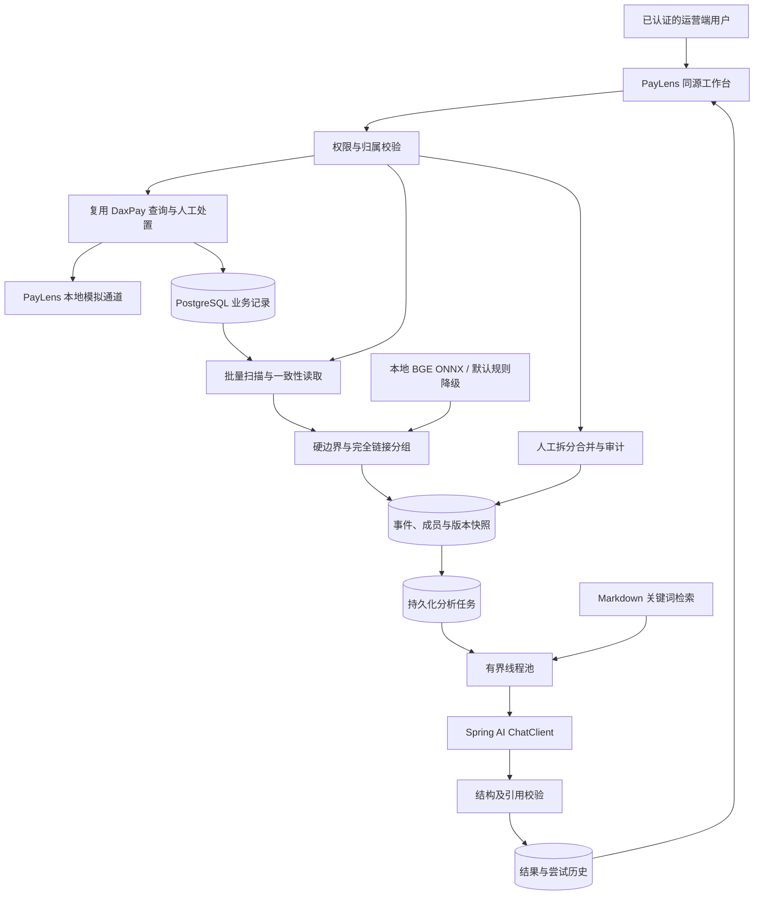
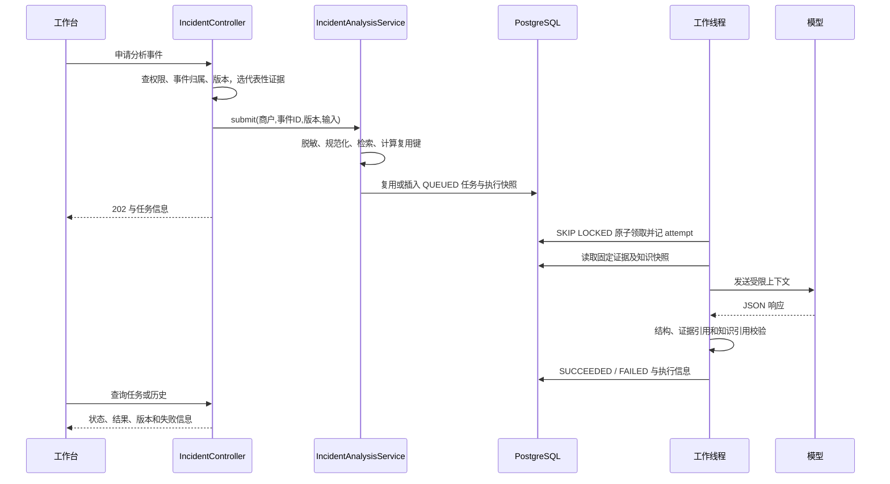

# PayLens 支付异常事件工作台：项目面试复习资料

> 整理日期：2026-09-28。仅覆盖 PayLens，不包含根目录 AI RCA Starter。
>
> 依据：当前工作区源码、项目说明、2026-09-25～26 的测试与评测记录。本次为代码阅读和资料整理，没有重新运行业务测试或调用真实模型。文中“已验证”均指仓库历史记录所记载的验证范围。
>
> 使用方法：先掌握第 1～4 章的项目叙述和业务链路，再复习第 5～11 章的技术实现，最后用第 12～15 章练习追问、难点复盘和演示。参考回答中的“我”应按自己的真实参与范围改写；源码存在不等于这些代码全部由本人完成。

## 目录

1. [项目定位与介绍话术](#一项目定位与介绍话术)
2. [架构、模块与技术选型](#二架构模块与技术选型)
3. [支付业务与状态边界](#三支付业务与状态边界)
4. [从请求到结果的完整链路](#四从请求到结果的完整链路)
5. [异步任务、幂等与恢复](#五异步任务幂等与恢复)
6. [事件归并算法与本地向量模型](#六事件归并算法与本地向量模型)
7. [知识检索、提示词与输出校验](#七知识检索提示词与输出校验)
8. [人工拆分合并、版本与审计](#八人工拆分合并版本与审计)
9. [数据模型、事务与并发](#九数据模型事务与并发)
10. [权限、脱敏与资源控制](#十权限脱敏与资源控制)
11. [测试、评测与数字口径](#十一测试评测与数字口径)
12. [25 道高频面试题及参考回答](#十二25-道高频面试题及参考回答)
13. [三个可展开的技术难点](#十三三个可展开的技术难点)
14. [当前不足与改进路线](#十四当前不足与改进路线)
15. [演示、复习计划与临场速记](#十五演示复习计划与临场速记)
16. [源码与证据索引](#十六源码与证据索引)

## 一、项目定位与介绍话术

### 1.1 一句话说明

**PayLens 是基于 DaxPay 二次开发的支付异常事件工作台，把支付记录整理成可追溯证据，支持受规则约束的事件归并、异步 AI 辅助分析和人工复核。**

它解决的场景是：订单状态、回调记录、查单结果分散在不同位置，出现不一致时，排查者需要来回查记录、比较时间、寻找可能原因。PayLens 将这些信息汇总，并把“已经看到的事实”和“还要验证的解释”分开呈现。

项目定位为本地求职演示。模拟通道不接真实支付机构，没有真实清算、账务总账、自动退款或自动修复能力。

### 1.2 业务价值怎么说

可以讲清三个价值，但不要给没有数据的百分比：

- **集中证据**：用来源 ID 和时间线关联订单、回调、查单及异常处理记录，减少人工寻找上下文的步骤。
- **组织异常**：把多条观察记录组织成事件，展示影响交易数、时间范围和类型分布，并允许人工调整。
- **辅助排查**：生成附带证据与知识引用的待验证解释和核查步骤，帮助运营或开发人员继续查证。

不要把“更方便查看证据”直接说成“平均故障恢复时间下降 80%”。后者需要真实对照实验。

### 1.3 60 秒版本

> 我做的是 PayLens 支付异常事件工作台，基于开源 DaxPay 二次开发，主要面向回调丢失、关单后迟到成功、查单超时等异常场景。
>
> 项目复用 DaxPay 的支付状态处理和权限体系，我重点介绍的扩展是证据时间线、批量事件扫描、可审计的事件归并，以及带版本快照的异步 AI 分析。AI 根据脱敏证据和最多三段故障知识生成排查建议，服务端会校验 JSON 类型和引用是否合法，模型不参与资金状态修改。
>
> 工程上比较关键的是 PostgreSQL 持久化任务队列、包含多个版本维度的复用键，以及人工拆分合并的事务和版本冲突处理。项目还接入了本机 BGE ONNX 向量推理，但保留集召回率不理想，所以语义自动合并默认关闭。这是本地演示项目，现有评测也不足以证明 RAG 提高诊断准确率。

### 1.4 3 分钟版本的展开顺序

| 时间 | 讲什么 | 应交代的细节 |
|---|---|---|
| 前 30 秒 | 场景与来源 | DaxPay 二次开发；本地模拟支付；解决异常排查上下文分散 |
| 30～75 秒 | 一条具体链路 | 本地关单→迟到成功回调→异常台账→证据→AI→人工重查与处置 |
| 75～125 秒 | 两个技术难点 | 持久化异步分析与版本复用；并发调整与审计 |
| 125～155 秒 | AI 工程 | 关键词检索、引用校验、本地向量归并及默认降级 |
| 最后 25 秒 | 验证与限制 | 业务并发回归、真实模型失败样例、没有生产规模结论 |

### 1.5 贡献边界必须讲清

| 范围 | 应如何表述 |
|---|---|
| 支付下单、回调、同步、关单、订单状态处理 | 基于并复用 DaxPay 既有体系；可以讲透原理，不默认归为个人从零实现 |
| 登录、管理端权限、商户体系 | 复用平台能力，PayLens 增加工作台入口限制与归属校验 |
| PayLens 模拟通道、证据汇总、工作台 | PayLens 扩展范围；具体个人贡献需按实际提交与经历陈述 |
| 分析任务、模型适配、引用校验、评测 | PayLens 重点技术范围 |
| 事件扫描、归并、拆分合并、版本审计 | PayLens 重点技术范围 |
| 线上用户数、生产交易量、公司级收益 | 当前材料不支持，不填写虚构数字 |

上游固定版本在项目说明中记录为 DaxPay `4.0.0-beta7`、提交 `58c27954e64528226da3cc86b1338fdde6720cb3`。PayLens 当前工作区包含上游及本地扩展；本资料不根据文件所在目录推断个人作者身份。

## 二、架构、模块与技术选型

### 2.1 实际技术栈

| 技术 | 当前用途 | 面试时的边界 |
|---|---|---|
| Java 25 | PayLens 所在 DaxPay 工程语言基线 | 不能说已验证 Java 21 兼容；根目录另一工程的 Java 版本不适用于此处 |
| Spring Boot 4.1.1 | 应用装配、Web、配置、调度 | 版本以 PayLens 父 POM 为准 |
| Spring AI 2.0.1 | ChatClient、Embedding 抽象 | 没有因使用框架就自动获得正确性或完整 Agent 能力 |
| PostgreSQL | 业务记录、任务、快照、事件、修订、向量缓存 | AI 任务领取直接使用 PostgreSQL，没有用 Artemis 消费 AI 任务 |
| Redis | DaxPay 基础设施与支付交易锁 | 不把 Redis 描述成 PayLens 所有缓存或事件队列的载体 |
| Apache Artemis | 上游运行基础设施中的消息组件 | 讲 AI 分析队列时应讲数据库实现 |
| ONNX Runtime Java + tokenizer | 本机 CPU 执行 BGE 向量推理 | 模型文件预先准备，启动时不在线下载 |
| BGE-small-zh-v1.5 | 异常描述的语义相似度 | 当前不用于故障知识检索 |
| 同源工作台 | 查看事件、触发分析和人工调整 | 依赖已有管理端登录会话，仓库不包含上游完整独立管理前端 |

### 2.2 模块划分

| 模块 | 主要职责 | 核心类 |
|---|---|---|
| `paylens-demo` | 模拟支付适配、证据读取、批次与工作台 API、人工调整 | `PayLensScenarioService`、`PayLensAnomalyFacade`、`PayLensIncidentBatchService`、`PayLensIncidentAdjustmentService` |
| `paylens-incidents` | 纯领域归并规则与算法 | `Observation`、`GroupingPolicy`、`CompleteLinkGrouper` |
| `paylens-analysis` | 单笔/事件分析任务、模型调用、检索、校验、本地向量适配 | `DiagnosticAnalysisService`、`IncidentAnalysisService`、`IncidentAnalysisRepository`、`BgeSmallZhOnnxEmbeddingModel` |
| `paylens-integration-tests` | PostgreSQL 真实事务与竞争测试 | `AnalysisTaskRepositoryIT`、`IncidentAdjustmentIT` |
| `daxpay-start` | 装配启动应用 | 启动配置与打包入口 |
| DaxPay 支付核心等模块 | 支付状态流转、认证与基础能力 | `PayCallbackService`、`PaySyncService`、`AbnormalOrderService` |

拆出归并领域模块的意义：算法只依赖观察记录、策略和相似度接口，可以在不启动 Web、不连数据库、不调用模型的情况下验证边界、排序和分组行为。

### 2.3 架构图



图中的 AI 分析只有读取证据、生成建议的路径。支付状态变化由用户操作和 DaxPay 确定性业务逻辑完成。

### 2.4 为什么不用更复杂的方案

当前是单实例、有限批量的演示，数据库已经保存业务和分析快照，用数据库任务表可以直接实现唯一约束、状态机、尝试历史与恢复，排查成本较低。不能把“基础设施里有消息队列”当成必须额外维护一条分析消息链路的理由。

知识库规模有限且内容是明确的支付状态和错误场景，关键词检索便于解释、测试和复现。向量化知识检索、重排序、独立向量数据库属于可评估的后续方案，不能写成已落地。

## 三、支付业务与状态边界

### 3.1 先区分四类状态

| 状态类别 | 含义 | 例子 |
|---|---|---|
| 本地交易资金状态 | DaxPay 当前记录的交易结果 | `init`、`processing`、`success`、`close`、`fail`、`cancel` |
| 通道观察状态 | 最近一次回调或查询看到的结果 | 明确成功、处理中、未知 |
| 异常单处理状态 | 人是否处理了业务异常 | `pending`、`confirmed`、`ignored` |
| PayLens 任务/事件状态 | 分析和组织工作进展 | 任务 `QUEUED/RUNNING/SUCCEEDED/FAILED`；事件 `OPEN/ARCHIVED` |

“AI 分析成功”只说明分析任务通过了程序校验，不等于支付成功，也不等于根因已确认。“事件归档”也不意味着资金已处理完毕。

### 3.2 五类演示场景

| 场景 | 观察到什么 | 正确处理 |
|---|---|---|
| 正常成功回调 | 本地处理中，通道回调成功 | 由 DaxPay 正常转成功，留下回调记录 |
| 通道成功、回调丢失 | 通道成功，本地仍处理中 | 主动查单或回放模拟回调，让业务同步逻辑处理 |
| 本地关单后迟到成功 | 本地已经 `close`，通道后来返回成功 | 不直接翻转终态，建立待处理异常记录，再人工核实 |
| 重复成功回调 | 同一成功结果反复到达 | 业务效果保持幂等，回调审计仍可记录多次到达 |
| 查单超时、结果未知 | 没有可信的成功或失败结果 | 保持未知语义，不因超时推断支付失败，不贸然重新支付 |

### 3.3 终态守卫为什么重要

当前回调核心逻辑允许 `INIT/PROCESSING` 收到成功后转为 `SUCCESS`；已经成功则幂等忽略。`FAIL/CLOSE/CANCEL` 收到成功时转入异常处理，而不是自动覆盖终态。

原因：支付状态冲突可能涉及业务订单已关闭、库存释放或后续履约判断。通道成功是一条重要证据，但不能把它等同于所有上下游都已准备好接受状态逆转。

这里是当前代码的业务策略，不应推广成所有支付平台都必须采用的统一规则。

### 3.4 人工确认成功的链路

`PayLensController.confirmSuccess` 的处理顺序是：

1. 读取异常与交易，验证专用演示商户归属。
2. 校验用户备注。
3. 通过 DaxPay 同步入口重新查单。
4. 校验返回证据的交易号匹配，且通道状态明确为 `success`。
5. 在正确商户上下文中调用 DaxPay 管理端异常处理服务。
6. DaxPay 在交易锁和事务保护下检查待处理状态、处理资金状态并写审计。

需要准确表述：重新查单和确认不是跨外部通道的一个分布式原子事务；最新证据提高可信度，内部并发一致性仍依赖交易锁和状态守卫。AI 不提供这条路径的授权凭据。

### 3.5 幂等不等于只留一条日志

仓库历史回归里，同一模拟交易提交 100 次相同成功回调，回调表记录 100 行，最终交易为成功、异常单为 0。这个案例说明：**重复请求可以有多份审计，业务副作用仍必须受控。**

## 四、从请求到结果的完整链路

### 4.1 单笔诊断链路

```text
用户打开交易/异常单
→ 校验管理端权限和商户归属
→ PayLensAnomalyFacade 汇总订单、回调、查单、异常及模拟事件摘要
→ 形成带 ID、类型和时间的 DiagnosticEvidence
→ DiagnosticAnalysisService 脱敏、裁剪并保存快照
→ 复用已有任务或持久化新任务
→ 工作线程检索故障知识、调用模型
→ 校验结构及证据/知识引用
→ 保存成功结果或稳定失败码
→ 前端查看历史与导出报告
```

单笔时间线可含明确标记的模拟事件。批量事件归并使用的来源读取器不同，不将模拟场景名称、预期答案或测试标签作为归并特征。不要混讲两条证据构建路径。

### 4.2 批次扫描链路

1. 调用 `POST /paylens/api/incident-batches`，提交时间范围与幂等键。
2. 默认扫描最近一小时；单次跨度最多 24 小时，结束时间不可超过当前时间 60 秒以上。
3. 以 `(mch_no, idempotency_key)` 唯一约束创建批次，重复提交复用原批次。
4. 扫描执行器领取批次，将 `QUEUED` 条件更新为 `RUNNING`。
5. 在只读、可重复读事务中读取异常订单、失败/未知查单、失败支付回调。
6. 各来源查询上限 501；合并后超过 500 条观察则失败，提示缩小范围，避免静默截断后冒充完整事件。
7. 语义自动合并开启、校准 ID 非空且模型就绪时尝试语义分组，否则规则分组。
8. 将输入快照、事件、成员、算法信息、Java 统计结果及批次完成状态在写事务中保存。

快照读取时间是工作线程执行时，不是 HTTP 提交的瞬间。当前重复幂等键会返回原批次，不比较后来提交的时间范围是否一致；严格的“同键不同载荷报冲突”可作为改进。

### 4.3 事件分析链路



代表性证据最多 20 条，当前选择策略优先覆盖阶段/异常类型/错误码组合，并补首尾与其他观察。代码用不同 key 放入同一个映射，同一观察可能重复进入；所以“最多 20 条列表项”不应说成“保证 20 条互异证据”。这是第 14 章可改进点。

### 4.4 常用接口速查

以下均以 `/paylens/api` 为前缀，正常 JSON 响应还包在 DaxPay `Result` 中。

| 方法与路径 | 作用 | 动作权限 |
|---|---|---|
| `POST /incident-batches` | 创建扫描批次 | MANAGE |
| `GET /incident-batches/{batchId}` | 查批次 | VIEW |
| `GET /incident-batches/{batchId}/incidents` | 分页查事件 | VIEW |
| `GET /incidents/{incidentId}` | 事件与成员详情 | VIEW |
| `POST /incidents/{incidentId}/analyses` | 提交分析 | MANAGE |
| `GET /incidents/{incidentId}/analyses` | 分页历史 | VIEW |
| `POST /incidents/{incidentId}/analyses/{analysisId}/retry` | 显式重试失败任务 | MANAGE |
| `GET /incidents/{incidentId}/analyses/{analysisId}/report` | 导出 Markdown | VIEW |
| `POST /incidents/{incidentId}/split` | 带期望版本拆分 | MANAGE |
| `POST /incidents/merge` | 合并版本列表 | MANAGE |
| `POST /incidents/{incidentId}/refresh` | 刷新关联交易状态分布 | VIEW |

常见响应：任务受理 `202`；分析队列满 `429`；版本冲突或要求重新分析 `409`。扫描线程池拒绝与分析队列拒绝不是同一种机制，扫描当前会把批次记为 `FAILED/SCAN_QUEUE_FULL`。

## 五、异步任务、幂等与恢复

### 5.1 为什么不能在请求线程等模型

历史事件模型评测中，完整响应延迟中位数约 51 秒。这种外部调用不适合绑定用户请求线程等候。异步化允许先返回任务标识，再查询状态，也让并发数、队列长度和失败恢复有独立管理入口。

HTTP 请求仍需完成权限验证、构建输入、检索及持久化等前置工作。准确说法是“模型调用不在请求线程执行”，不是“接口完全没有耗时”。

### 5.2 状态机

```text
提交 → QUEUED → 原子领取 → RUNNING → SUCCEEDED
                         └────────→ FAILED
FAILED --用户显式重试且版本未变化--> QUEUED
重启时遗留 RUNNING → FAILED(PROCESS_RESTARTED)
重启时遗留 QUEUED → 重新调度
```

`attempt` 记录一次具体尝试；task 记录一个固定输入与执行版本的分析任务。重试增加尝试记录，不抹去失败历史。

### 5.3 事件分析复用键

当前事件链路近似为：

```text
SHA256(
  商户号 + 事件ID + 事件版本 + 规范化证据快照哈希
  + 模型配置哈希 + 提示词材料哈希 + 输出Schema版本
  + 知识库版本 + 本次检索片段快照哈希
)
```

关键理解：

- **商户维度**隔离租户数据；不能只按异常文本缓存。
- **事件与版本**保证人工调整后不复用旧版本诊断。
- **证据快照**防止同一事件增加证据后错误复用。
- **模型配置**包含地址、模型、温度、JSON 模式和超时参数；不能只保存模型展示名称。
- **提示词、Schema、知识版本**将输入契约纳入结果身份。
- **检索结果哈希**保证具体给模型看的知识可追溯。

事件输入对 Map key、证据顺序做规范化，以避免等价输入仅因序列化顺序变化而产生不必要的新任务。SHA-256 在这里用于内容标识，不是加密和权限控制。

### 5.4 去重为什么要数据库兜底

“先查有没有，再插入”存在竞态：两个请求都可能查不到。事件任务仓储在事务里使用事务级 advisory lock，查询复用键、检查排队数，再插入；数据库的 `reuse_key` 唯一约束和 `ON CONFLICT` 作为最终约束。

当前去重表示相同执行输入复用同一任务，也可能复用一个失败任务。失败后应走显式 retry；不是每次点击分析都会重新调用模型。

### 5.5 原子领取 SQL

```sql
WITH next_task AS (
  SELECT id
  FROM paylens_incident_analysis
  WHERE status = 'QUEUED'
  ORDER BY created_at, id
  LIMIT 1
  FOR UPDATE SKIP LOCKED
)
UPDATE paylens_incident_analysis task
SET status = 'RUNNING', updated_at = now()
FROM next_task
WHERE task.id = next_task.id
RETURNING task.id;
```

`FOR UPDATE` 锁住候选行；`SKIP LOCKED` 让其他领取者跳过已锁定的行；状态更新与返回 ID 属于同一领取操作。领取与创建 attempt 在事务内完成，模型网络调用在领取事务结束后执行，避免长时间占用数据库事务。

能解释这条 SQL 的竞争语义，不代表系统已完成多实例验证。当前重启恢复会批量修改全部 RUNNING 任务，没有 owner/lease，直接多实例部署可能干扰其他仍活着的实例。

### 5.6 背压与执行器

分析线程池配置为固定 2 个工作线程、内存队列容量 50、`AbortPolicy`。单笔和事件分析共用这一执行器，数据库还限制两类 `QUEUED` 任务合计不超过 50。

这里有两个不同的队列：

- 数据库队列保存持久任务，是恢复和历史查询的依据。
- 线程池队列保存执行唤醒/处理工作项，不与数据库任务数严格一一对应。

不用 `CallerRunsPolicy` 的理由是，线程池满时不能把模型调用反压回 HTTP 请求线程。事件分析唤醒被拒绝后，持久化任务仍在，后续定时调度与工作线程结束时会再唤醒。

排队上限是 QUEUED 数，不是“系统最多只能存在 50 个历史任务”，也不包括已经 RUNNING 的数量。

### 5.7 为什么重启后不自动重试 RUNNING

进程可能在模型已返回、但本地结果未持久化时退出。再次调用可能重复计费，且同一输入的文本不保证完全相同。当前选择标记 `PROCESS_RESTARTED`，让用户显式重试；待领取任务则恢复调度。

因此系统并不保证“模型调用 exactly-once”。它实现的是数据库任务去重与受控尝试记录，对外部模型的执行与本地提交之间仍存在故障窗口。

### 5.8 版本变化为什么要重新分析

执行前和 retry 时检查模型配置、提示词、Schema、知识版本。版本不一致时返回 `REANALYSIS_REQUIRED`，要求以新的执行配置创建分析。

这区分了两件事：重试是重新执行同一个分析条件；重新分析是创建新条件下的结果。事件 retry 继续使用旧快照，不等于自动读取事件最新成员。

## 六、事件归并算法与本地向量模型

### 6.1 Observation 与 Incident 的区别

`Observation` 是一条来源记录产生的观察，包含来源 ID、交易号、商户、业务类型、阶段、通道、异常类型、错误码、时间与规范化描述。

`Incident` 是一组观察的组织结果。一笔交易可能有多条观察；一组事件也可能关联多笔交易。因此统计要分别记录观察数和去重交易数。

### 6.2 硬边界优先

自动归并先判断已知字段是否冲突，再判断相似度。当前规则细节是：

- 两条记录的商户、业务类型、阶段、通道、异常类型均已知但不同，则不能合并。
- 两边错误码均已知且不一致，则不能合并。
- 同一交易可以在部分字段未知时继续检查，但明确冲突仍不允许绕过。
- 跨交易要求商户、业务类型、阶段、通道和异常类型都已知且相等。
- 还必须满足时间窗口和相似度阈值。

不能说“错误码永远必须相同”：一方未知时，代码没有按错误码不同直接拒绝。也不能说“同一交易永远能合并”：明确冲突、时间窗和相似度仍然约束它。

### 6.3 为什么采用完全链接约束

设阈值为 0.82，存在三条异常：

```text
sim(A, B) = 0.91
sim(B, C) = 0.90
sim(A, C) = 0.63
```

如果只要求新成员与组里某一条相似，C 可以通过 B 加入，从而把不相似的 A 和 C 串在一起。当前实现要求候选和组内每个成员都过线，因此会阻止这一合并。

当前算法是**确定性的贪心完全链接分组**，不是每一步全局寻找最优簇对的标准层次聚类。准确描述实现比只说“用了聚类算法”更有价值。

### 6.4 算法步骤

1. 按观察 ID 去重；同 ID 内容冲突直接拒绝。
2. 按时间、ID、交易号及边界字段稳定排序。
3. 顺序处理每个候选，遍历已有组。
4. 检查候选与组最早记录的时间差，最长 10 分钟。
5. 对组内每个成员检查硬边界和相似度。
6. 多组可加入时，选加入后最小两两相似度最高的组；相同分数保留最早创建的组。
7. 都不能加入则新建组，记录算法版本和最小两两相似度。

时间窗口基于组最早时间，不是“只要每两条相邻记录相差不超过 10 分钟”，因此不会无限延长成一条长链。

不计向量生成，最坏需要比较 O(n²) 个记录对；相似度缓存也可能占 O(n²) 空间。n 最大 500 时无序记录对为 124,750，对本地受限批次可以分析其上界，但尚无容量测试证明对应耗时。

### 6.5 本地 BGE 推理链路

```text
异常描述规范化
→ 查询文本/模型/预处理版本缓存
→ tokenizer 批量编码
→ input_ids、attention_mask、可选 token_type_ids
→ ONNX Runtime CPU 推理
→ last_hidden_state 的第 0 个 token（CLS）
→ L2 归一化
→ 512 维向量
→ 点积计算相似度
```

归一化后的向量满足 `||u||₂ = ||v||₂ = 1`，因此余弦相似度等于点积 `u·v`。当前实现将数值夹在 [-1,1] 范围内，并拒绝无效向量或维度不匹配。

这里读取本地 `model.onnx`、`tokenizer.json` 和 manifest，验证模型 ID、修订、模型/分词器 SHA-256、维度与预处理约定。历史记录还将 Java 输出与 Transformers 参考实现比较，最大差异约 `1.23e-7`。

这证明数值适配与参考实现接近，不能证明业务语义归并效果好。

### 6.6 向量缓存设计

缓存主键为：

```text
text_sha256 + model_sha256 + preprocess_version
```

向量存在 PostgreSQL JSONB 中，当前没有 pgvector 索引或 ANN 检索。模型文件或预处理变了，旧向量不能直接混用。

相似度服务先批量准备向量，放入当前线程的临时 Map，避免每次 pair 比较都重复推理；批次结束在 finally 中清理 ThreadLocal。面试关联知识点：线程池会复用线程，ThreadLocal 不清理可能延长对象生命周期并污染后续任务。

### 6.7 降级与实际效果

语义路径要求开关开启、校准标识非空、模型就绪；推理失败时整批回到规则路径，标记 `RULE_ONLY`。规则路径仍保留硬边界和时间窗，但描述相等给 1.0，不等给 0.0。

注意：代码检查校准 ID 非空，并不等于校验了一份签名的、完整可追溯的校准报告。严格的校准发布门禁仍可增强。

历史评测开发集选择阈值 0.82，但保留集完全链接召回率只有 **5/450 = 1.11%**。即使没有观测到误合并，也漏掉了绝大多数同类关系，所以默认关闭语义自动合并。

还有一个不能混淆的配置：扫描服务构造器的阈值默认值是 0.90，0.82 是这轮评测的候选值。不能把评测选值直接说成所有运行环境的已启用配置。

## 七、知识检索、提示词与输出校验

### 7.1 当前 RAG 是怎样实现的

`MarkdownKnowledgeRetriever` 加载 `classpath*:paylens/knowledge/*.md`，每个文档以头部元信息提供 ID、标题、关键词和适用状态，正文作为知识内容。

检索过程：

1. 将异常类型、本地/通道状态与证据摘要拼接为匹配文本。
2. 单笔诊断按知识适用状态过滤；聚合事件由于状态可能混合，跳过该单笔状态过滤。
3. 统计关键词子串命中，长度大于 3 的词加 2，否则加 1。
4. 得分大于 0 才返回，按分数降序、知识 ID 排序打破平局。
5. 最多取 3 段，连同 ID 放入模型输入。

这属于可解释的关键词检索增强生成。没有 BM25、向量召回、重排序、自动文档切块或 Agent 自主检索循环。

### 7.2 知识版本为什么重要

知识版本摘要包括检索器版本标记、排序后的文件名和文件内容。知识正文或规则更新后，分析的上下文语义可能变化，因此需要影响复用键，并在执行记录中保留具体检索片段。

事件服务为了稳定序列化，会把检索到的 top-3 再按 ID 排序保存。因此“选中了最高分的三段”成立，但最终 prompt 的片段顺序不一定是相关性降序。

### 7.3 为什么要把事实、解释和核查分开

事件输出的核心结构是：

| 字段 | 意义 | 服务端约束举例 |
|---|---|---|
| `commonPhenomenon` | 共同现象 | 非空，长度最多 1200 |
| `facts` | 已有证据支持的事实 | 最多 12 项，声明与证据 ID 必须有效 |
| `differences` | 组内差异 | 最多 12 项，必须有证据引用 |
| `possibleExplanations` | 待验证解释 | 最多 3 项，含 hypothesis、evidenceIds、字符串 verification |
| `checkSteps` | 后续核查步骤 | 最多 8 项 |
| `missingInformation` | 仍缺的信息 | 最多 8 项 |
| `knowledgeCitations` | 使用的知识 ID | 只能来自本次检索集合 |
| `knowledgeOmissionReason` | 检索到了但没采用的理由 | 必要时填写，最多 500 字符 |
| `knowledgeUseStatus` | 服务端判定的知识使用状态 | `NO_MATCH`、`NOT_USED`、`CITED` |

交易数、金额、时间范围等统计由 Java 计算并单独保存，不让模型生成一个未经校验的数字来覆盖业务统计。

### 7.4 三层校验

**第一层：语法。** 能否解析 JSON；否则 `INVALID_JSON`。

**第二层：结构。** 根节点、字段类型、必填字段、列表长度是否符合契约；否则 `INVALID_STRUCTURE`。合法 JSON 不等于符合业务 Schema。

**第三层：引用。** facts、differences、possibleExplanations 的证据 ID 必须在当前输入集合内；知识引用必须来自本次检索集合。越界分别返回 `INVALID_EVIDENCE_REFERENCE` 或 `INVALID_KNOWLEDGE_CITATION`。

引用存在只证明来源标识可追溯，不证明该来源支持模型的推论。比如证据是“查单超时”，模型引用这个真实 ID 却断言“资金已失败”，ID 校验仍不能识别全部语义错误。

### 7.5 真实 bad case：verification 数组

事件分析 v1 评测的 38 个响应里，有 15 个把 `possibleExplanations[].verification` 输出为数组，而代码要求字符串；另一个响应引用不存在的 `statistics` 证据 ID。

应这样复盘：

- 现象：服务商返回了合法 JSON，应用仍失败。
- 定位：问题是字段类型契约不清，而非所有失败都属于网络或 JSON 语法错误。
- 修改：v2 明确列出字段类型，特别指出 verification 必须是字符串；服务端区分 INVALID_JSON 与 INVALID_STRUCTURE。
- 验证：本地契约测试通过；当前记录尚未执行 v2 真实模型评测，不能宣布问题已在线消除。

### 7.6 模型适配与请求限制

适配器采用 Spring AI ChatClient，配置温度 0.1、JSON Object 模式和 `maxRetries(0)`，对连接、读写与整体请求设置超时；HTTP 429 与其他 HTTP 错误映射到稳定失败码，响应体超过 64 KiB 拒绝。

JSON Object 模式不等于严格 JSON Schema，低温也不等于确定性输出。项目的真实失败样例正好说明还需要应用校验。

`NoOpTemplateRenderer` 避免已序列化 JSON 的花括号被模板系统错误解释，但它不是 Prompt Injection 防护机制。Prompt 将证据声明为数据，真正限制支付影响的是应用根本没有给模型支付写入工具。

## 八、人工拆分合并、版本与审计

### 8.1 为什么需要人工调整

自动分组反映的是有限特征上的相似，不是已经确认的共同根因。不同故障可能表述相似，同一故障也可能跨表达方式。因此需要保留人工拆分、合并的入口和理由。

### 8.2 拆分约束

- 用户带上 `expectedVersion`，避免旧页面覆盖新数据。
- 服务端锁定事件，验证版本，拒绝已归档事件。
- 对拆分组进行完整集合检查：每条现有观察必须恰好出现一次，不得遗漏、重复或引入外部观察。
- 锁定批次，保护组号等共同数据。
- 主分区沿用原事件并增加版本，其余创建新事件。
- 迁移成员、更新统计、保存修订均在同一事务里完成。

### 8.3 合并约束

- 选择 2～50 个事件，必须同一扫描批次、同一演示商户。
- 按稳定 ID 顺序加行锁，再校验各事件期望版本。
- 校验业务类型、阶段、通道、异常类型等兼容性。
- 按创建时间、ID 稳定选择目标事件，不依赖前端请求顺序。
- 成员移入目标，目标版本增加；来源事件增加版本并标为 `ARCHIVED`。
- 操作者来自认证会话，备注不能为空且有长度上限。

当前人工合并并没有复用自动分组的“10 分钟 + 完全链接阈值”约束。人工可调整相似性判断，但应记录理由，不要在面试中说两条路径完全采用同一规则。

### 8.4 行锁与版本号分别解决什么

行锁负责当前事务之间串行化，防止同时改成员；版本号负责识别“用户基于旧视图发出的操作”。只有行锁时，第二个人等到锁后依然可能把旧决定应用到新数据。组合使用才能给出明确的版本冲突。

事务更新仍带 `WHERE version = expectedVersion` 并检查影响行数，失败返回 `409 INCIDENT_VERSION_CONFLICT`。

### 8.5 历史分析如何处理

事件成员改变后版本递增，旧分析仍保存旧事件版本和证据快照；新分析使用新版本，复用键不同。这样能解释“为什么昨天的建议和今天不同”，而不是覆盖历史。

旧报告不是最新事件的自动真相。展示时应该核对事件版本和分析版本；显式 retry 旧任务仍分析旧快照。

## 九、数据模型、事务与并发

### 9.1 核心表

| 表 | 保存什么 | 关键约束或索引 |
|---|---|---|
| `paylens_incident_batch` | 扫描范围、输入快照、状态、执行模式 | 唯一 `(mch_no,idempotency_key)` |
| `paylens_incident` | 当前事件版本、统计、分组依据 | 唯一 `(batch_id,group_no)`；商户/时间索引 |
| `paylens_incident_member` | 观察归属与观察快照 | 主键 `(batch_id,observation_id)` |
| `paylens_incident_revision` | 历史版本、操作人、原因、快照 | 唯一 `(incident_id,version)` |
| `paylens_embedding_cache` | 文本对应的本地向量 | 文本哈希+模型哈希+预处理版本主键 |
| `paylens_incident_analysis` | 事件分析任务与固定执行输入 | 唯一 `reuse_key`；状态/创建时间索引 |
| `paylens_incident_analysis_attempt` | 每次尝试、耗时、失败码与 Token | 唯一 `(analysis_id,attempt_no)` |
| `paylens_analysis_task` / `paylens_analysis_attempt` | 单笔诊断的任务与尝试 | 与事件分析分别存储，共享排队容量控制 |

成员主键只保证同一批次的一条 observation 只有一个当前归属；跨批次再次扫描可以包含同一来源记录。不要说成全系统永远不会重复出现该记录。

### 9.2 为什么结构化列与 JSONB 混合

商户、状态、版本、时间等高频过滤字段用结构化列，有利于索引与约束；证据、统计、执行配置等快照用 JSONB，便于完整保留当时输入。

代价是类型约束更多依赖 Java 校验和版本治理，JSONB 并不自动保证所有业务字段正确。也不能因为使用 JSONB 就宣称数据库已经支持向量近邻检索。

### 9.3 一致性读取与统计

ObservationReader 使用可重复读事务，将三类来源读入一个数据库视图，降低跨表读取过程中记录变化造成的混杂。事务结束后才执行推理，避免长事务。

扫描保存统计前，金额另外查询；人工调整统计也重新读取交易金额。因此不能把整个事件、成员和金额描述为“所有字段来自同一个 MVCC 快照”。若业务要求完全同一时点，应进一步统一采集边界。

金额按交易号去重，再按币种分别使用 `BigInteger` 累加最小货币单位。不用浮点累加，不把不同币种合成一个没有意义的总数。这里是关联订单金额统计，不能等同于已确认损失或实际到账金额。

### 9.4 支付锁为什么在事务外层

当前支付回调等路径结构为：

```text
定位交易 → 获取 payment:trade:{tradeId} 锁
  → 通过 self Spring 代理进入 @Transactional 方法
    → 重新读取最新状态 → 守卫与写入
  → 事务提交，代理调用返回
→ 释放交易锁
```

若先开启外层事务，再在方法内部释放锁，方法返回后事务代理才提交，就会出现“锁已释放但事务尚未提交”的窗口。第二个线程拿到锁可能读到旧状态。

`this.xxx()` 直接调用同一个对象的方法通常绕过 Spring 代理；这里通过懒加载 self 代理进入事务方法。也可以拆成锁编排 Bean 与事务 Bean，这是等价的结构改进思路，不是当前必须改动。

### 9.5 三种幂等不要混讲

| 幂等对象 | 关键机制 |
|---|---|
| 支付结果与异常处置 | 统一交易锁、持锁重读、终态守卫、待处理条件更新、异常单唯一约束 |
| 分析提交 | 内容与执行版本复用键、数据库唯一约束、持久任务 |
| 批次扫描 | 商户+客户端幂等键唯一约束 |

锁降低冲突，唯一键维护数据库不变量，状态条件更新防止不合法流转。不能用“加了 Redis 锁，所以永远不会重复”概括所有场景。

## 十、权限、脱敏与资源控制

### 10.1 权限的四层检查

1. **身份**：复用 DaxPay 已认证会话。
2. **客户端身份**：`PayLensAdminClientInterceptor` 从会话用户获取 clientCode，只允许运营管理端，不能靠请求头伪造。
3. **功能权限**：异常订单菜单权限 + VIEW/MANAGE 动作权限。
4. **数据归属**：专用演示商户、交易/事件归属及任务与事件绑定关系。

管理端登录了不等于拥有所有操作权限；拥有事件查看权限也不意味着可读取任意 analysisId。事件任务读取同时检查商户和任务所属事件。

当前主要围绕配置的演示商户工作，不能描述成已完成任意租户自助接入的 SaaS 产品。

### 10.2 脱敏策略

证据优先使用摘要，避免发送完整回调报文、认证头、通道密钥；供应商原始错误可转换成 TIMEOUT、NETWORK_FAILURE 等类别。自由文本再经正则掩码处理邮箱、手机号、密码/密钥赋值、Bearer 等模式。

正则是尽力而为，可能有漏报和误报。可靠性来自字段白名单、最小化采集、摘要分类与脱敏叠加，不应声称“正则已保证所有敏感信息绝不外发”。

### 10.3 模型的能力边界

当前不是自主支付 Agent。模型没有支付写工具，不会自行循环查单、确认资金、退款或重放回调。它只接收固定输入、产生受限分析。

这使提示注入即使影响文本，也没有直接资金执行通路，但仍可能生成误导性建议，因此引用校验、人工核查与语义评测仍必需。

### 10.4 限额速记

| 限额 | 当前实现 |
|---|---|
| 单次扫描时间 | 最多 24 小时 |
| 归并时间跨度 | 最多 10 分钟 |
| 单批观察数 | 最多 500，超过则失败 |
| 分析工作线程 | 2 |
| 分析执行器内存队列 | 50 |
| 两类持久化分析的排队数 | QUEUED 合计最多 50 |
| 扫描执行器 | 1 个线程、队列 20 |
| 单笔分析证据 | 最多 30 条，单条摘要裁剪至 2000 字符 |
| 事件分析证据 | 控制器选最多 20 条列表项 |
| 分析快照和最终 prompt | 分别校验 UTF-8 字节数不超过 16 KiB |
| 检索知识 | 最多 3 段 |
| HTTP 模型响应体 | 最多 64 KiB |
| 分页 pageSize | 最多 50 |
| 人工合并事件数 | 2～50 |
| 人工事件调整备注 | 1～500 字符 |

字节、字符、Token 是不同单位。16 KiB 是内存/传输输入限额，不是模型的 16K Token 上下文；2000 字符也不等于 2000 Token。单笔证据裁剪规则不能套用到事件链路。

### 10.5 可观测性

模型适配层通过 Micrometer 记录调用次数、耗时与 prompt/completion Token；任务层保存状态、失败码、执行版本与 attempt。

必须区分：适配层成功表示拿到模型响应；任务成功还需结构与引用校验通过。若模型返回了文本但业务校验失败，仅看模型 HTTP 成功率会高估可用性。

现有事件任务失败路径可能没有把已收到响应的 Token 写入 attempt，不能把任务表 Token 简单求和就当成完整账单。真实评测使用独立逐调用账本记录消耗。

## 十一、测试、评测与数字口径

### 11.1 三类验证各自证明什么

| 类型 | 可以证明 | 不能直接证明 |
|---|---|---|
| 单元/HTTP 契约测试 | 输入边界、状态转换、解析、失败码等满足断言 | 真实模型语义正确、真实渠道正确 |
| PostgreSQL/业务/浏览器集成 | 在记录环境下事务与工作流跑通 | 大规模吞吐、高可用、全部角色与渠道覆盖 |
| 真实模型离线评测 | 固定数据与版本下的实际模型行为 | 生产诊断准确率、普适 RAG 收益 |

### 11.2 可以引用的历史测试记录

| 项目 | 记录结果 | 使用时附带限定 |
|---|---|---|
| 分析模块单元测试 | 最新记录 46 项通过 | 2026-09-26，本次整理未重跑 |
| 归并领域 / 演示模块 | 同日此前 15 / 11 项通过 | 不是最新修改后全 reactor 同时重跑 |
| PostgreSQL 集成测试 | 10/10：任务 5 项、调整 5 项 | 隔离数据库，不能外推全支付系统 |
| 确认/忽略并发 | 20/20 轮通过 | 本地模拟业务，非生产容量测试 |
| 同步/回调并发 | 20/20 轮通过 | 本地固定场景 |
| 重复通知与审计 | 100/100 条记录核对通过 | 同一模拟交易，业务幂等不要求审计去重 |
| 新事件工作台浏览器闭环 | 扫描、分析、导出、拆分、合并、刷新通过 | 使用假模型与合成订单 |

虽然 46+15+11=72，但不能把分时执行结果说成“最终代码一次全量测试 72/72 通过”。原文说明最新改动只重跑分析模块。

### 11.3 事件模型 A/B：这组必须背准

固定 19 个合成事件，两个条件各一次，共 38 次请求，v1 提示词：

| 指标 | 仅证据 | 证据 + 检索 |
|---|---:|---:|
| 调用数 | 19 | 19 |
| 完整结构及引用校验通过 | 10/19，52.6% | 12/19，63.2% |
| AI 辅助语义评阅均分，满分 2 | 1.6316 | 1.6842 |
| 延迟中位数 | 51,498 ms | 50,766 ms |
| 延迟 P95 | 65,087 ms | 67,554 ms |

总完整校验通过率为 **22/38 = 57.9%**。配对语义分数：检索组 4 胜、4 负、11 平。评分是条件映射暂时隐藏的 AI 评阅；输出里的知识引用可能暴露条件，不是严格盲评，也不是独立人工标注。

**正确结论：** 当前样本未提供足够证据证明检索提升诊断质量。当前 v2 提示词补强了字段类型，但这 38 次数据属于 v1，不能归给 v2。

### 11.4 为什么 Recall@3=17/17 不能说准确率 100%

17 是有预标注匹配知识的案例数。这些案例 top-3 命中了候选知识，另两个没有候选知识的案例却也检索到了 `query-timeout`。

因此这个数字不衡量无答案场景误检，不衡量生成解释是否正确，也不说明每条返回片段都相关。当前数据更接近“有候选案例的 top-3 命中比例”；一般多相关文档任务的 Recall@K 还要按全部相关项计算。

### 11.5 归并评测：精确率与召回率分开说

开发集与保留集各 100 条记录、10 类现象，每份有 450 个同类正样本对和 4500 个异类负样本对。阈值在开发集搜索，然后冻结到保留集。

| 指标 | 开发集 | 保留集 |
|---|---:|---:|
| 候选阈值 | 0.82 | 固定 0.82 |
| 成对相似度召回 | 16/450 = 3.56% | 6/450 = 1.33% |
| 完全链接分组召回 | 9/450 = 2.00% | 5/450 = 1.11% |
| 此样本内分组精确率 | 100% | 100% |

精确率回答“实际合并的关系里多少正确”，召回率回答“应合并的关系里找回多少”。只合并极少数高置信关系就可能有很高精确率，但整体工作价值很有限。

所有评测样本硬边界相同，所以本组实验不能证明跨商户等边界阻断正确，那由领域测试另行覆盖。开发集和保留集由固定生成脚本产生合成语料，不应冒充真实生产分布。

### 11.6 Token、费用与耗时

事件评测共记录 21,892 prompt Token、162,323 completion Token。没有可核实的当次服务商费率，不能虚构费用。

若未来拿到价格，可按输入与输出各自计价计算。账本必须包含失败调用；失败不等于不收费。事件评测中位数/P95 采用 nearest-rank，需保留计算口径，不能和另一套 percentile 算法结果直接比较。

另外还有一组单笔诊断 20 案例×2 条件、共 40 次调用，记录 38 个结构有效结果。**它与事件诊断 38 次不是同一组实验**，不能混成“事件模型 95% 通过率”。

## 十二、25 道高频面试题及参考回答

本章为复习题库，包含回答要点，不是交互式模拟面试。优先练到能脱离文字讲清，再用源码确认细节。

### Q1：这个项目到底解决什么问题？

**参考回答：** 支付异常排查需要关联本地状态、回调、查单和人工处理记录。PayLens 将这些记录整理成有来源的证据，再组织成事件，提供受约束的 AI 排查建议。我强调的是证据组织、流程可追溯和人工辅助，不是模型直接判断资金结果。

**追问准备：** 为什么原有异常单列表不够？它能列业务异常，但跨记录证据、聚合事件、固定分析版本与知识引用是进一步扩展。

### Q2：你和 DaxPay 上游的工作怎么区分？

**参考回答：** 支付状态处理、商户体系、回调同步等主要基于上游。PayLens 的扩展集中在模拟通道、工作台、证据快照、事件归并、分析队列和评测。具体个人修改应按实际经历展开，不把上游支付平台规模当作我的成果。

**追问准备：** 准备一两个自己真正改过的类及改动原因，比背模块总数更能证明参与深度。

### Q3：完整讲一下“关单后迟到成功”。

**参考回答：** 本地关单后，模拟成功回调进入 DaxPay 回调服务。持有交易锁后重读状态，发现已经终态，就建立或更新待处理异常，保留本地终态。PayLens 展示相关证据并可触发分析。人工确认时重新查单，明确成功后再走 DaxPay 异常处置服务。

**追问准备：** 回调成功为什么不能直接覆盖 close？要考虑业务终态和下游副作用，不把单一证据当作全系统一致。

### Q4：超时为什么不能算失败？

**参考回答：** 超时说明客户端没有在期限内得到结果，通道可能已经完成操作。将超时当失败并重新支付，可能造成重复业务动作。项目用未知结果语义保留现状，等待后续可信查单或人工核实。

**追问准备：** 区分通信失败与业务失败；自动重试支付和重新查单不是相同风险等级的动作。

### Q5：重复回调怎样保证幂等？

**参考回答：** 当前支付核心用交易级锁串行化同一交易的相关路径，锁内重读状态，成功终态重复通知不再重复执行业务。异常记录另有待处理唯一约束。回调审计可以记录每次请求，幂等针对业务效果。

**追问准备：** 锁失效或进程故障后还靠什么？数据库约束、状态条件和可重试设计，而不是锁一个机制。

### Q6：为什么有了锁还要事务？

**参考回答：** 锁控制同一资源的并发进入，事务保证数据库多步写入一起提交或回滚。锁必须覆盖事务提交，当前通过外层持锁、内层代理事务实现。否则释放锁后到事务提交前会留下读旧状态的窗口。

**追问准备：** 解释 self 代理与 this 调用的差异，以及事务不是跨支付通道的全局事务。

### Q7：AI 分析异步化以后怎么保证任务不丢？

**参考回答：** 先将任务和输入快照持久化为 QUEUED，再唤醒有界线程池。线程池只是执行载体，重启可以继续领取未执行任务。RUNNING 遗留任务标记重启失败，保留尝试历史，让用户显式重试。

**追问准备：** 持久化成功但唤醒失败怎么办？事件分析靠后续定时调度和 worker 完成后的唤醒继续处理。

### Q8：为什么 AI 任务不用 MQ？

**参考回答：** 当前单实例演示规模有限，任务本身需要数据库保存证据、版本和审计，数据库队列减少额外一致性链路。领取使用 SKIP LOCKED，队列有上限。若未来吞吐和独立 worker 需求扩大，再评估消息队列、outbox 与消费者幂等。

**追问准备：** 项目依赖 Artemis 不代表 AI 使用 Artemis；也不代表数据库队列适合无限规模。

### Q9：100 个相同分析请求同时进来会怎样？

**参考回答：** 相同内容与执行版本生成相同复用键。事务级容量检查和唯一约束使其复用同一数据库任务，原子领取避免同一 QUEUED 任务被同时领取。历史任务集成测试覆盖了 100 路相同输入竞争，但不代表所有事件路径都做了同等规模测试。

**追问准备：** 证据不同或事件版本不同，应生成不同任务，不能为了节省调用错误复用。

### Q10：复用键为什么包含这么多版本？

**参考回答：** 分析输出取决于证据，也取决于模型参数、提示词和知识。只按交易号缓存会把旧证据或旧配置的结果当新结果。事件版本则隔离人工拆分合并前后的分析，执行快照让历史可解释。

**追问准备：** 同一个模型名称背后服务商权重可能更新；本地配置版本不能保证服务商输出完全可复现。

### Q11：系统能保证 exactly-once 吗？

**参考回答：** 不能保证外部模型调用恰好一次。模型返回与本地提交之间可能崩溃，本地无法确定远端是否已完成或计费。当前保证的是同条件任务去重、原子领取和尝试记录，重启后对 RUNNING 保守标失败。

**追问准备：** 外部提供幂等键、结果查询能力时可以进一步缩小不确定性，但当前未实现。

### Q12：线程池满了为什么不用 CallerRunsPolicy？

**参考回答：** 如果让提交线程执行模型调用，HTTP 请求又被几十秒的模型延迟占住，破坏隔离目标。当前使用 AbortPolicy，持久队列与调度负责后续推进，数据库排队容量满则明确返回过载。

**追问准备：** 用 Little 定律做量级推算：若平均调用 50 秒、并发 2，则理想上限约 0.04 次/秒。这只是估算，不是压测结果。

### Q13：为什么选完全链接？

**参考回答：** 支付异常误合并会把不同问题放在同一排查上下文里。完全链接要求候选与全部成员都足够相似，可以防止 A≈B、B≈C、A≉C 的链式误合并。代价是保守、召回低，也需要更多比较。

**追问准备：** 当前是稳定顺序下的贪心实现，不是全局最优聚类；解释最坏 O(n²) 与 500 条上限。

### Q14：向量模型具体在哪儿用？

**参考回答：** BGE 在本机把观察描述转成 512 维向量，用于事件归并的相似度计算。故障知识检索仍是 Markdown 关键词与状态规则，两条路径不同。

**追问准备：** 不要描述不存在的向量数据库、HNSW 索引或知识重排序。

### Q15：为什么自己适配 ONNX EmbeddingModel？

**参考回答：** 需要把模型要求的 token 输出、CLS 池化和 L2 归一化明确落实到 Java 运行时，并验证文件修订和参考结果。适配 Spring AI Embedding 抽象后，上层仍通过统一接口调用。历史数值对照接近参考实现，但业务效果还要单独评测。

**追问准备：** tokenization、pooling、normalization 哪一步变了都可能导致相似度分布改变，所以缓存要带预处理版本。

### Q16：阈值 0.82 怎么来的？为什么不开？

**参考回答：** 开发集在 0.80～0.98、步长 0.02 搜索，并要求精确率与相对规则召回门槛，再固定到保留集。保留集完全链接只找回 5/450 个同类关系，召回约 1.11%，所以不足以作为默认自动化能力。

**追问准备：** 不能反复在同一个保留集上调阈值后继续把它称为独立验证；应改进特征后准备新的保留集。

### Q17：RAG 真正带来提升了吗？

**参考回答：** 当前不能证明。事件 A/B 中完整校验由 10/19 到 12/19，但样本小，AI 辅助语义评阅配对是 4 胜4负11平，且不是真正独立人工盲评。因此我会展示可追溯检索机制和结果限制，不宣称准确率提升。

**追问准备：** 将结构可用性、引用合法性、语义正确性、检索召回拆开评价。

### Q18：引用校验能防幻觉吗？

**参考回答：** 它能拒绝引用不存在或不属于本次上下文的 ID，不能保证引用内容支持推论。项目将原因限定为待验证假设，并让人工核实。下一步要增加语义支持评阅与负例回归。

**追问准备：** 举“查单超时被说成资金失败”的例子，说明合法 ID 也可能被错误使用。

### Q19：模型返回合法 JSON 为什么还会失败？

**参考回答：** JSON 语法、字段类型和业务约束是三层。真实评测中 verification 输出数组而应用要求字符串，因此类型转换失败。v2 明确类型并新增测试，但尚无真实模型重测结果。

**追问准备：** 不把失败原始文本降格直接显示成“成功分析”，否则绕过了产品契约。

### Q20：怎么避免模型乱操作支付？

**参考回答：** 模型没有支付工具，只有固定证据输入和文本输出。真正的确认和忽略由用户通过有权限的接口触发，再调用 DaxPay 状态机和事务逻辑。Prompt 是辅助约束，能力隔离才是关键边界。

**追问准备：** 如果将来加入工具，必须另行设计授权、幂等和审计，不能沿用当前“只读分析”的风险判断。

### Q21：两个运营同时拆分、合并怎么办？

**参考回答：** 请求携带期望版本，事务里按固定顺序锁事件并检查版本，还锁批次；更新时附带版本条件，成员迁移和审计一并提交。旧版本操作返回 409，让客户端刷新后重新决策。

**追问准备：** 为什么既要锁又要版本？一个解决执行竞争，一个解决旧页面意图过期。

### Q22：怎么防止商户越权读别人的报告？

**参考回答：** 会话身份限制为运营端，再检查菜单和动作权限；查询绑定配置商户，事件任务还核验 incidentId 归属。不能只验证登录，也不能信任前端传来的 clientCode 或 taskId。

**追问准备：** 当前是演示商户范围，完整多租户扩展还需租户上下文、配额及所有查询路径审计。

### Q23：你测过什么，没测过什么？

**参考回答：** 仓库记录了单元/HTTP 契约、隔离 PostgreSQL、支付竞争与回调审计、权限矩阵、假模型浏览器流程，以及有限真实模型 A/B。没有生产容量、长期稳定性、全部角色和真实支付渠道验证。本次资料整理没有重新执行这些测试。

**追问准备：** 20 轮流程成功是正确性回归，不是峰值 QPS；单测数量也不是无缺陷证明。

### Q24：最值得优先优化哪里？

**参考回答：** 先完善事件证据选择与人工合并边界，再解决真实模型类型契约的可用性和评测闭环，而不是直接加更多模型。随后补任务/attempt 原子提交与多实例租约等工程边界。每项改动用对应失败样例回归。

**追问准备：** 能讲出明确失败条件、数据不变量和验收方式，比列“上微服务、上 MQ”更有说服力。

### Q25：如果面试官说“这不就是套模型 API”？

**参考回答：** 调用 API 只是生成环节。这个项目的主要工作还包括业务证据的可信采集、状态与建议隔离、输入和版本快照、任务去重与恢复、输出引用校验、人工调整审计，以及通过负面评测决定哪些能力不能默认启用。模型回答可以替换，但这些业务约束仍必须由应用维护。

**追问准备：** 主动用一个细节证明，例如“模型响应成功但 verification 类型错，任务仍失败”，或“拆分事件后旧分析保留旧版本”。

## 十三、三个可展开的技术难点

以下是按现有实现与记录组织的叙述模板，不代表替你认定个人开发经历。面试时把任务分工和动作替换为真实情况。

### 难点 A：让长耗时 AI 分析可追溯、可恢复

**背景：** 模型调用耗时长、可能失败，用户又会重复点击；事件成员和知识版本可能在分析前后变化。

**目标：** 避免重复创建相同分析，保存当时证据，失败有原因，恢复不丢待执行任务。

**做法：** 先落库固定输入和版本，使用内容与版本复用键；数据库原子领取，独立 worker 调用模型；结果校验后保存，attempt 记录每次尝试；重启将未完成执行标失败，待领取任务继续调度。

**可说明的结果：** 历史任务集成测试验证了并发去重、队列上限、尝试历史与恢复；未证明外部模型 exactly-once 或多实例高可用。

**连续追问：** 为什么不用内存 Map？→ 重启丢失且缺持久审计。为什么哈希输入？→ 区分执行身份。为什么模型调用不放事务里？→ 避免长期占锁和连接。拿到响应后进程挂了？→ 当前保守标失败，外部调用存在不确定性。

### 难点 B：不让相似文本覆盖业务边界

**背景：** 多商户、多通道的错误可能使用相似描述，简单相似度容易误合并；完全依赖规则又难处理同义表达。

**目标：** 分组可解释、可重现、可人工修正。

**做法：** 先限定商户/阶段/通道/类型等边界，再在 10 分钟窗口内执行稳定的完全链接分组；本地向量有模型与预处理版本；人工调整保存事件版本、成员快照和原因。

**可说明的结果：** 数值对照与规则测试提供了实现证据，但保留集召回只有 1.11%，所以自动语义合并默认关闭。

**连续追问：** 没误合并为什么不开？→ 合并太少，不足以减少工作量。直接降阈值？→ 必须评估误合并代价并使用新的保留集。换大模型？→ 先验证输入特征与错误分布，不能假定模型更大就解决问题。

### 难点 C：把“返回了文本”变成“应用可使用的结果”

**背景：** 真实模型返回的 JSON 可能语法正确但类型错误，也可能编造证据 ID。

**目标：** 区分传输成功、结构成功和语义质量，避免不合格文本进入成功报告。

**做法：** 设置结构对象与条数约束，证据和知识 ID 白名单；记录稳定失败码；对真实 bad case 明确提示词字段类型，并保留版本隔离。

**可说明的结果：** v1 的 22/38 完整校验通过说明问题暴露出来了；v2 本地测试通过仅证明契约改动合理，仍需新的真实评测证明提升。

**连续追问：** 结构化输出是否解决幻觉？→ 不解决语义支持。引用合法是否可信？→ 需要核对证据与结论。能自动修 JSON 吗？→ 可以作为受预算和审计约束的后续策略，不能无限重试或默默改写事实。

## 十四、当前不足与改进路线

### 14.1 代码阅读发现的改进候选

下表为静态阅读推导，未在本次任务中运行失败复现或修改业务代码。面试时应说“我会补充验证”，不要说成已修复成果。

| 优先级 | 当前现象或边界 | 改进和验证方式 |
|---|---|---|
| 高 | 事件代表证据按类别、EARLIEST、LATEST、OBS-ID 多种 key 放入 Map，同一观察可能重复 | 统一按 observation ID 去重，同时保留覆盖策略；验证容量不被重复证据占用、omitted 计数正确 |
| 高 | 人工合并错误码只与首条记录比较；若首条错误码未知，后续两个不同已知错误码可能都通过 | 收集所有非空错误码，要求集合大小最多 1，或复用成对边界；补“首条空、后两条不同”的反例 |
| 高 | 任务完成状态和 attempt 完成更新是分开的写操作，未在该方法中包成统一事务 | 用短事务一致提交，注入第二次写失败验证不会出现任务成功但 attempt 仍运行 |
| 高 | 恢复逻辑全局处理 RUNNING，没有 worker 所有权和租约 | 多实例前引入 owner、lease/heartbeat、过期领取与 fencing；验证一个实例重启不误伤另一个 |
| 中 | 批次幂等键重复时直接返回原范围 | 保存请求摘要，同键不同范围返回冲突；补并发与重复载荷用例 |
| 中 | 本地 embedding 等待 `Future.get()` 没有显式超时 | 增加受控等待、取消和降级策略；模拟本地推理卡住，验证扫描线程能恢复 |
| 中 | 事件历史列表按 ID 再逐条查详情、版本与 attempt | 按分页批量加载，减少 N+1 查询；以 SQL 数和实际延迟验证，未测前不报优化比例 |
| 中 | 分组金额另查、调整时又重算，和观察快照不是统一采集时点 | 根据业务需求明确“历史影响快照”与“当前业务状态”，必要时冻结金额及采集时间 |
| 中 | 失败模型响应的 Token 未必完整进入任务 attempt；适配成功指标不等于业务成功 | 保留响应元数据并分别统计 provider_success、validation_success、task_success |
| 中 | 校准标识仅检查非空，缓存预处理版本主要依赖人工维护 | 将校准数据、模型、分词器及参数摘要绑定，校验后才允许启用语义路径 |

### 14.2 AI 效果的下一步

先处理类型契约，再扩大语义评测，而不是只看更好看的生成文本。

1. 固定 v2 提示词、模型参数、知识版本与新数据集，明确调用预算。
2. 覆盖无证据、证据冲突、未知资金结果、无知识匹配、误导性引用等负例。
3. 将格式通过率、引用合法率、语义支持率、错误资金建议率分别记录。
4. 做仅证据/证据加检索的配对比较，加入独立人工评阅，避免从输出字段泄露实验条件。
5. 针对无匹配误检调关键词/拒绝阈值，再决定是否值得尝试混合检索。

### 14.3 规模扩大时再考虑什么

当前缺少容量和多实例实测，以下均为设计题答案，不是已实现成果：

- 将 worker 独立部署，增加租约恢复、商户配额和模型限流。
- 当数据库领取和写入成为瓶颈时，再评估 MQ、outbox、死信与消费者幂等。
- 归并先按硬边界和时间分桶，再减少候选 pair；数据大后评估近邻召回，但最终仍应检查组内边界。
- 大型知识库先准备检索标注与无答案负例，再比较关键词、BM25、向量与重排序。
- 增加快照与向量缓存保留策略、历史归档、数据库索引和真实查询计划分析。
- 为写支付的流程保留强权限、审计和人工判断，不因生成质量提高就默认允许自动执行。

## 十五、演示、复习计划与临场速记

### 15.1 五分钟演示顺序

| 时间 | 操作 | 讲解重点 |
|---|---|---|
| 0:00～0:40 | 打开已有登录会话的工作台 | 二次开发范围、模拟环境、权限 |
| 0:40～1:30 | 创建关单后迟到成功场景并看证据 | 终态守卫、异常单、按时间看状态 |
| 1:30～2:15 | 扫描异常并打开事件 | 观察与事件区别、规则模式、统计 |
| 2:15～3:00 | 提交 mock 分析、查看任务和引用 | 异步、版本、事实/解释区分；声明演示用假模型 |
| 3:00～3:45 | 展示兼容事件拆分/合并和历史 | 期望版本、事务、审计 |
| 3:45～4:30 | 重新查单、人工确认或忽略 | AI 不控制支付；确认要有明确通道证据 |
| 4:30～5:00 | 打开真实评测报告 | 区分假模型流程与真实模型效果；解释低召回和 v1 类型失败 |

不依赖现场云端模型调用来证明代码能力，提前准备历史真实评测及截图即可。假模型只证明流程，不把假模型输出当成真实推理质量。

### 15.2 运行与复习定位

构建基准是 PayLens 子工程，不能在外层 AI RCA 根 POM 上套用下面命令。示例显式进入目录，遵循本工作区 PowerShell 7 / RTK 约定：

```powershell
# 单元回归；执行前确认本机 JDK 25 与 Maven 环境
rtk pwsh -NoLogo -NoProfile -Command "Set-Location -LiteralPath 'D:\workspace\java_ai\paylens'; mvn -B -pl paylens-analysis,paylens-incidents,paylens-demo -am test"

# 查看 PostgreSQL 集成脚本后，在需要复验时运行
rtk pwsh -NoLogo -NoProfile -Command "Set-Location -LiteralPath 'D:\workspace\java_ai\paylens'; ./scripts/test-paylens-postgres-integration.ps1"
```

完整启动流程以项目 README 为准。数据库初始化脚本只用于空库，不能为了面试演示在已有数据上重复初始化。此处仅提供复习入口，本次未执行这些命令。

### 15.3 三天复习安排

| 时间 | 任务 | 验收方式 |
|---|---|---|
| 第一天上午 | 项目定位、架构、贡献边界 | 不看资料完成 60 秒与 3 分钟介绍 |
| 第一天下午 | 五类支付场景、锁与事务 | 手画迟到成功链路，解释锁释放与事务提交顺序 |
| 第二天上午 | 分析任务、复用键、领取 SQL、恢复 | 写出状态机；回答“响应后崩溃怎么办” |
| 第二天下午 | 完全链接、Embedding、人工版本 | 手算 A/B/C 例子，讲清向量和 RAG 是两条路径 |
| 第三天上午 | 测试与评测数字 | 区分 40 次单笔与 38 次事件评测，解释 1.11% |
| 第三天下午 | 25 题口述与五分钟演示 | 每题先讲结论，再给代码机制、证据与边界 |

### 15.4 面试前十分钟速记

- 项目定位：DaxPay 二次开发、本地支付异常辅助排查。
- 主要扩展：证据、事件、版本化异步分析、人工审计。
- Java 25 / Boot 4.1.1 / Spring AI 2.0.1，别混用外层工程版本。
- 本地 BGE 用于归并；RAG 是关键词检索，最多三段。
- 自动分组：硬边界 + 最长 10 分钟 + 确定性贪心完全链接。
- 任务：先落库，原子领取，2 个分析线程，QUEUED 合计上限 50。
- 复用：商户、事件版本、证据与执行版本；不是只按订单号。
- 支付并发：同交易锁、锁内重读、锁覆盖事务提交、状态与唯一约束。
- 人工调整：行锁 + expectedVersion + 成员完整性 + 修订快照。
- 输出：JSON 语法、字段结构、引用合法性；仍不能证明语义正确。
- 事件 v1：22/38 完整校验通过；v2 尚未真实模型复测。
- 归并保留集：5/450，召回 1.11%，因此自动语义合并关闭。
- 不能声称：RAG 准确率显著提升、生产高并发、自动修复、真实资金闭环。

## 十六、源码与证据索引

按“先业务、后任务、再算法、最后评测”的顺序阅读。链接指向本地当前工作区，行号省略以减少后续编辑造成的漂移。

| 阅读目的 | 源码/资料 |
|---|---|
| 项目范围与启动 | [PayLens README](../../docs/paylens/README.md) |
| 父工程技术版本 | [PayLens pom.xml](../../pom.xml) |
| 单笔证据如何生成 | [PayLensAnomalyFacade.java](../../paylens-demo/src/main/java/cn/daxpay/open/paylens/demo/PayLensAnomalyFacade.java) |
| 人工确认与查单 | [PayLensController.java](../../paylens-demo/src/main/java/cn/daxpay/open/paylens/demo/PayLensController.java) |
| 支付锁与终态守卫 | [PayCallbackService.java](../../daxpay-payment/daxpay-payment-core/src/main/java/cn/daxpay/open/payment/trade/runtime/service/callback/PayCallbackService.java) |
| 异常确认、忽略与条件更新 | [AbnormalOrderService.java](../../daxpay-payment/daxpay-payment-core/src/main/java/cn/daxpay/open/payment/trade/abnormal/service/AbnormalOrderService.java) |
| 批次来源和读取隔离 | [PayLensIncidentObservationReader.java](../../paylens-demo/src/main/java/cn/daxpay/open/paylens/demo/PayLensIncidentObservationReader.java) |
| 批次与规则降级 | [PayLensIncidentBatchService.java](../../paylens-demo/src/main/java/cn/daxpay/open/paylens/demo/PayLensIncidentBatchService.java) |
| 完全链接实现 | [CompleteLinkGrouper.java](../../paylens-incidents/src/main/java/cn/daxpay/open/paylens/incidents/domain/CompleteLinkGrouper.java) |
| 阈值与窗口限制 | [GroupingPolicy.java](../../paylens-incidents/src/main/java/cn/daxpay/open/paylens/incidents/domain/GroupingPolicy.java) |
| 向量缓存与相似度 | [PayLensIncidentSimilarityProvider.java](../../paylens-demo/src/main/java/cn/daxpay/open/paylens/demo/PayLensIncidentSimilarityProvider.java) |
| 本地 ONNX 适配 | [BgeSmallZhOnnxEmbeddingModel.java](../../paylens-analysis/src/main/java/cn/daxpay/open/paylens/analysis/BgeSmallZhOnnxEmbeddingModel.java) |
| 事件 API 与证据选择 | [PayLensIncidentController.java](../../paylens-demo/src/main/java/cn/daxpay/open/paylens/demo/PayLensIncidentController.java) |
| 事件分析复用与执行 | [IncidentAnalysisService.java](../../paylens-analysis/src/main/java/cn/daxpay/open/paylens/analysis/IncidentAnalysisService.java) |
| 领取 SQL、容量与 attempt | [IncidentAnalysisRepository.java](../../paylens-analysis/src/main/java/cn/daxpay/open/paylens/analysis/IncidentAnalysisRepository.java) |
| 单笔分析证据限制 | [DiagnosticAnalysisService.java](../../paylens-analysis/src/main/java/cn/daxpay/open/paylens/analysis/DiagnosticAnalysisService.java) |
| 分析线程池 | [PayLensAnalysisConfiguration.java](../../paylens-analysis/src/main/java/cn/daxpay/open/paylens/analysis/PayLensAnalysisConfiguration.java) |
| 模型请求、超时和监控 | [OpenAiCompatibleDiagnosticModel.java](../../paylens-analysis/src/main/java/cn/daxpay/open/paylens/analysis/OpenAiCompatibleDiagnosticModel.java) |
| 关键词检索 | [MarkdownKnowledgeRetriever.java](../../paylens-analysis/src/main/java/cn/daxpay/open/paylens/analysis/MarkdownKnowledgeRetriever.java) |
| v2 提示词与版本 | [IncidentAnalysisPromptBuilder.java](../../paylens-analysis/src/main/java/cn/daxpay/open/paylens/analysis/IncidentAnalysisPromptBuilder.java) |
| 输出与引用校验 | [IncidentAnalysisJsonValidator.java](../../paylens-analysis/src/main/java/cn/daxpay/open/paylens/analysis/IncidentAnalysisJsonValidator.java) |
| 拆分合并与修订 | [PayLensIncidentAdjustmentService.java](../../paylens-demo/src/main/java/cn/daxpay/open/paylens/demo/PayLensIncidentAdjustmentService.java) |
| 事件表结构 | [V003__incident_workbench.sql](../../paylens-demo/src/main/resources/db/migration/V003__incident_workbench.sql) |
| 运营端身份限制 | [PayLensAdminClientInterceptor.java](../../paylens-demo/src/main/java/cn/daxpay/open/paylens/demo/PayLensAdminClientInterceptor.java) |
| 文本脱敏规则 | [SensitiveTextSanitizer.java](../../paylens-analysis/src/main/java/cn/daxpay/open/paylens/analysis/SensitiveTextSanitizer.java) |
| 测试证据与限制 | [test-plan.md](../../docs/paylens/test-plan.md) |
| 归并评测 | [grouping-evaluation-report.md](../../docs/paylens/grouping-evaluation-report.md) |
| 事件 38 次真实模型评测 | [incident-evaluation-report.md](../../docs/paylens/incident-evaluation-report.md) |
| 单笔 40 次真实模型评测 | [evaluation-report.md](../../docs/paylens/evaluation-report.md) |

复习时每个技术点尽量准备四句话：为什么需要、代码怎样做、如何验证、还有什么边界。能把这四句话和一个真实例子连起来，就能应对多数项目深挖。
